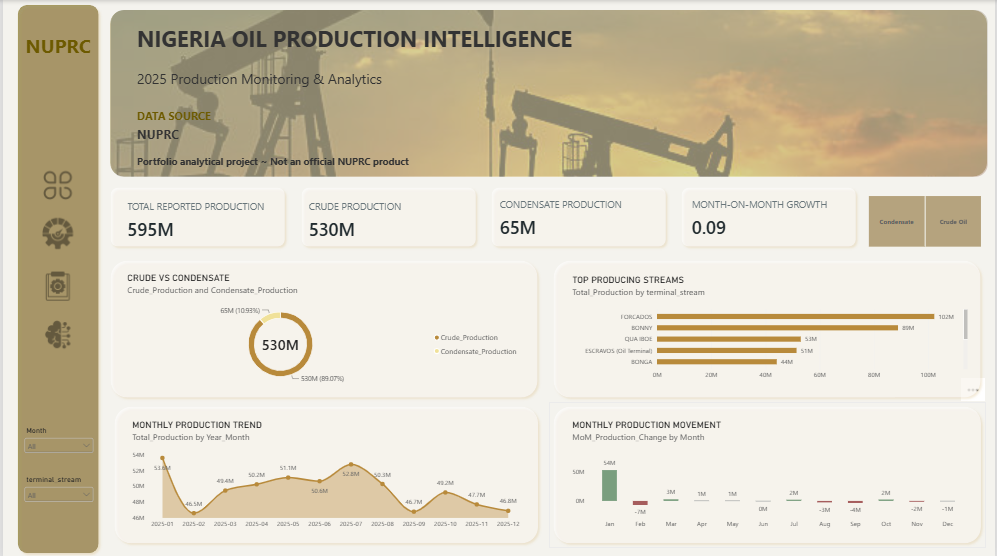
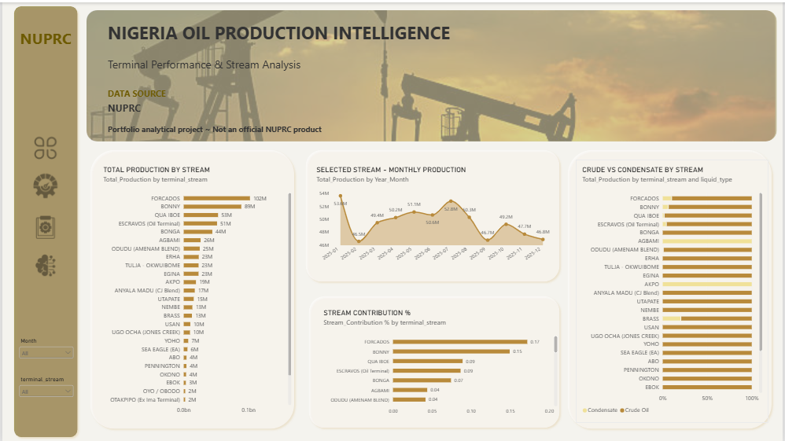
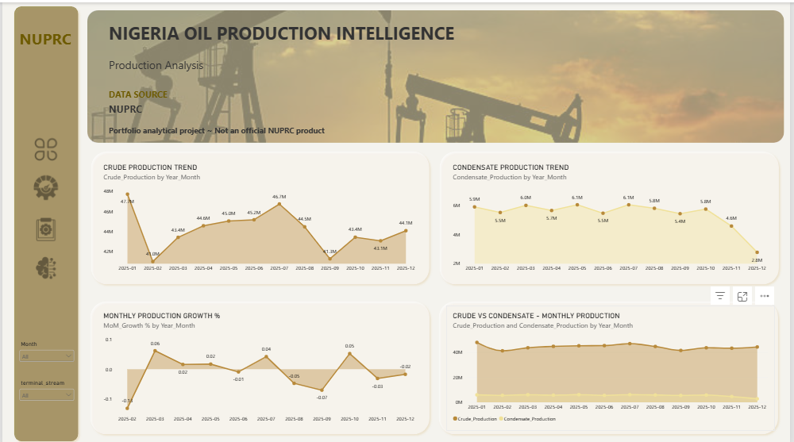
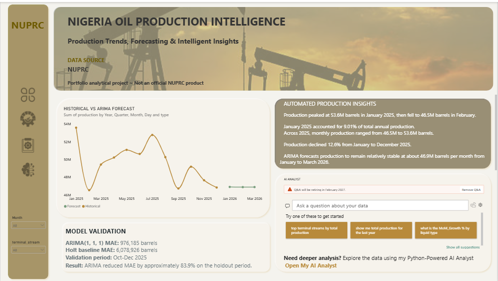
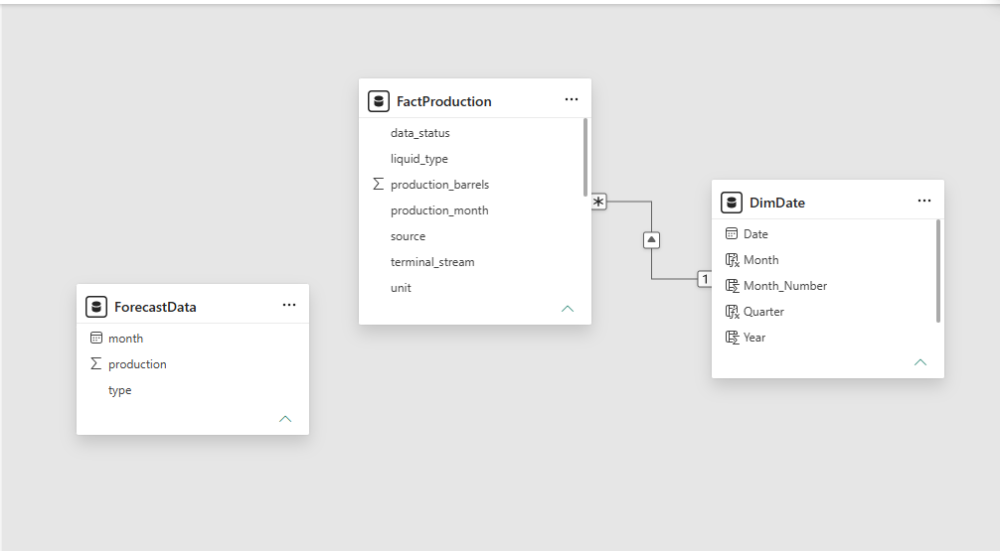
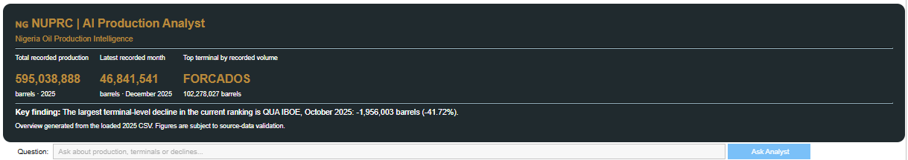

# Nigeria Oil Production Intelligence Dashboard (NUPRC, 2025)

An end-to-end analytics project on Nigeria's 2025 crude oil and condensate production: data preparation, SQL, a Power BI dashboard, a short-term forecast, and a Python "AI Analyst" that answers questions about the data.

> Portfolio project. Not an official NUPRC product.



## The question

How did Nigeria's crude oil and condensate production change across 2025, which terminals drove it, and what can the data say about the next few months?

## Key findings

- **595M barrels** were reported in 2025: 530M crude oil (89%) and 65M condensate (11%).
- **Forcados (102M) and Bonny (89M)** are the two largest streams. Forcados alone is about 17% of the total.
- Monthly output fell **12.6% from January (53.6M) to December (46.8M)**.
- **QUA IBOE** dropped 41.7% from September to October (-1,956,003 barrels). The drop is entirely crude oil; condensate rose slightly. The data does not explain why.
- Monthly totals are uneven (for example, a sharp fall in February), so the year is not a smooth decline.

## Tools

MySQL · Power BI · DAX · Python (pandas, statsmodels) · Google Colab

## Data

- Source: NUPRC, "Crude Oil and Condensate Production - 2025" (monthly figures by terminal and liquid type). Report link: https://www.nuprc.gov.ng/wp-content/uploads/2026/01/JAN-TO-DEC-2025-PRODUCTION-002.pdf
- I converted the PDF's month columns into a long table: one row per month, terminal and liquid type (`data/NUPRC_2025_Oil_Production_Long.csv`).
- Final analysis table: 417 rows, 29 terminal streams, January to December 2025.
- Column meanings are in `data/DATA_DICTIONARY.md`.

### Data decisions

| Decision | Why |
|---|---|
| Missing values stay missing, not zero | A blank in the report is not proof of zero production |
| "Blend Total" rows removed | They are totals; keeping them would double-count |
| `data_status` column kept (reported / not_reported / reconciled) | Shows which figures are less certain |
| Some January and September figures flagged | Needed reconciliation against monthly totals |

**Row count:** the analysis dataset has 417 rows (Blend Total rows are not included).

## How it was built

1. **SQL** (`sql/`): load the CSV, check row counts, date range, nulls, duplicates and terminal names, then summarise by month, terminal and liquid type.
2. **Power BI model** (`powerbi/`): a `FactProduction` table linked to a `DimDate` calendar table (one date to many production rows, single direction). `ForecastData` is a separate table used only for the forecast chart.
3. **DAX measures** (`powerbi/dax_measures.md`): total, crude and condensate production, month-on-month change and growth, crude and condensate share, stream contribution.
4. **Dashboard** (4 pages): Executive Overview, Terminal Performance, Production Analysis, AI & Forecasting.
5. **Forecasting** (`python/01_forecasting.ipynb`): ARIMA(1,1,1) compared with Holt's trend method on a 3-month holdout.
6. **Analyst tool** (`python/02_ai_analyst.ipynb`): a rule-based question-answering tool in Google Colab. It uses pandas to filter, group and calculate, and Python rules to recognise supported questions and choose the calculation. `ipywidgets` provides the question box and "Ask Analyst" button, and HTML displays the results. It does not use a language model or any API key.

## Dashboard pages

| Page | What it shows |
|---|---|
| Executive Overview | Headline totals, crude vs condensate split, top streams, monthly trend |
| Terminal Performance | Production and share by terminal stream |
| Production Analysis | Crude and condensate trends, month-on-month growth |
| AI & Forecasting | Forecast, model check, automated insights, link to the AI Analyst |






## Forecast and how far to trust it

Both models were tested on October to December 2025 after training on the earlier months.

| Model | Average error (MAE) |
|---|---|
| ARIMA(1,1,1) | 976,185 barrels |
| Holt (trend) | 6,078,926 barrels |

ARIMA's error was about 84% lower than Holt's on this test. ARIMA projects roughly 46.9M barrels a month for January to March 2026.

**Limits:** only 12 monthly points and a 3-month test. Treat this as an exploratory forecast, not a prediction to plan around.

## AI Analyst



[](https://colab.research.google.com/github/Success-Ramsey/nigeria-oil-production-dashboard/blob/main/python/02_ai_analyst.ipynb)

In Colab, choose Runtime, then Run all, then type a question about production, terminals or declines. It is rule-based, so it only answers the question types it was built for. No API keys are needed.

## Limitations

- One year of data, so no seasonality or long-term trend can be measured.
- Monthly totals are not adjusted for month length (February has 28 days). Barrels per day would be a fairer comparison.
- Some January and September values were reconciled, so those months carry more uncertainty.
- Reasons behind changes (maintenance, shutdowns, theft, reporting gaps) are not in the data.

## Next steps

- Add barrels per day.
- Add more years of NUPRC data to test seasonality.
- Add a naive and a seasonal benchmark to the forecast.

## Repository structure

```
├── data/        CSV and data dictionary
├── sql/         setup, load and exploration queries
├── powerbi/     .pbix file, DAX measures, model screenshot
├── python/      forecasting and AI Analyst notebooks
├── images/      dashboard screenshots
└── docs/        methodology notes
```

## Author

Success Eruchi Ramsey · Data analyst, Port Harcourt, Nigeria
[LinkedIn](https://www.linkedin.com/in/Success-Ramsey-445a46260/)

## Credits

Data: NUPRC (public report). Background image and icons: [https://www.flaticon.com] [https://media.istockphoto.com].
README.md
Displaying README.md.
